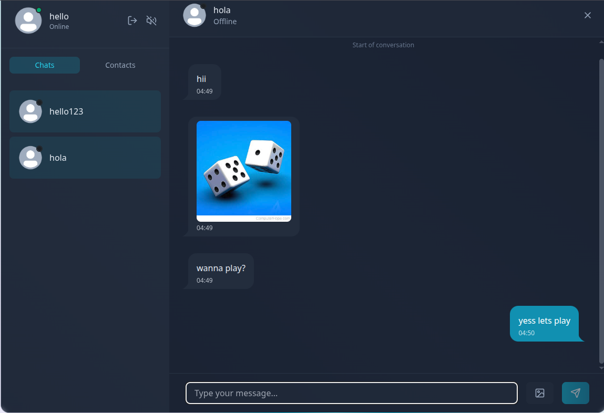

# Chitchat 💬

A full-stack real-time messaging app built with React, Node.js, Express, Socket.io and MongoDB, load-tested and tuned for performance.

**[Live demo](https://chitchat-723h.onrender.com)** · hosted on Render's free tier, so the first load can take 30–60 seconds while the server wakes up.




---

## Performance

I load-tested the API and the chat-history query, found the bottlenecks, and fixed them. The scripts used are in [`backend/src/scripts`](backend/src/scripts), so the results can be reproduced.

### 1. Chat history: compound index + cursor-based pagination

Opening a chat used to fetch the **entire** conversation. I added a compound index on `{ senderId, receiverId, createdAt }` and changed the endpoint to return the latest 50 messages, with older ones loaded on demand via `?before=<timestamp>`.

Measured on a seeded dataset of **50,000 messages** (average of 5 runs):

| Metric | Before | After |
|---|---|---|
| Documents scanned per load | 50,042 | **50** |
| Load time | 1.47 s | **0.26 s** (5.6× faster) |
| Response size | 2.3 MB | **11 KB** |

### 2. Auth middleware: in-memory user cache

Every authenticated request was looking up the user in MongoDB. I added an in-memory cache (60 s TTL, invalidated when the profile changes), which halves the database calls per request.

Load-tested with [autocannon](https://github.com/mcollina/autocannon) at **100 concurrent connections**:

| Metric | Before | After |
|---|---|---|
| Throughput | 44 req/s | **75 req/s** (+72%) |
| Median latency | 1.9 s | **1.0 s** (−47%) |

> These absolute numbers are limited by the free-tier MongoDB Atlas cluster (capped at 100 operations/second), which is exactly why cutting database calls had such a large effect.

### Reproduce it

```bash
cd backend
node src/scripts/seed.js      # creates test users + 50,000 messages
node src/scripts/measure.js   # times the chat-history query and prints docs examined / size
node src/scripts/cleanup.js   # removes all the test data
```

<!-- TODO: add the exact autocannon command you used, e.g.
npx autocannon -c 100 -d 30 -H "Cookie: jwt=<token>" http://localhost:3000/api/... -->
Set `DISABLE_ARCJET=true` while load-testing, otherwise rate limiting blocks the test traffic.

---

## Features

- **Real-time messaging** over Socket.io, with live online/offline presence
- **Media sharing**: image uploads stored on Cloudinary
- **Audio notifications** for incoming messages and keystrokes
- **Authentication**: JWT stored in HTTP-only cookies, passwords hashed with bcrypt
- **Abuse protection**: Arcjet rate limiting and bot detection on the API
- **Onboarding emails** sent through Resend on signup
- **Responsive UI** built with Tailwind CSS, with Zustand for state management

## Architecture

```
React (Vite) + Zustand  ──REST (axios)──▶  Express API ──▶ MongoDB (Mongoose)
        ▲                                      │
        └──────────── Socket.io ◀──────────────┘   newMessage, getOnlineUsers
```

- The REST API handles auth, contacts and message history. Sending a message saves it, then pushes it to the receiver's socket if they are online.
- The socket server keeps a `userId → socketId` map and broadcasts the online-user list on every connect/disconnect.

### API

| Method | Endpoint | Description |
|---|---|---|
| POST | `/api/auth/signup` | Create an account (sends welcome email) |
| POST | `/api/auth/login` | Log in, sets JWT cookie |
| POST | `/api/auth/logout` | Clear the session |
| PUT | `/api/auth/update-profile` | Update profile picture |
| GET | `/api/auth/check` | Return the logged-in user |
| GET | `/api/messages/contacts` | All users you can chat with |
| GET | `/api/messages/chats` | Users you have chatted with |
| GET | `/api/messages/chats/:userId` | Paginated history (`?before=`, `?limit=` up to 100) |
| POST | `/api/messages/send/:userId` | Send a text and/or image message |

## Tech stack

| Layer | Tools |
|---|---|
| Frontend | React 19, Vite, Zustand, Tailwind CSS, Socket.io client, Axios |
| Backend | Node.js, Express, Socket.io, Mongoose, JWT, bcrypt |
| Database | MongoDB Atlas |
| Services | Cloudinary (media), Arcjet (rate limiting), Resend (email) |
| Deployment | Render |

## Getting started

**Prerequisites:** Node.js 20+, a MongoDB connection string, and accounts for Cloudinary, Arcjet and Resend.

```bash
git clone https://github.com/HiteshBajajft9/chatclone.git
cd chatclone
npm install --prefix backend
npm install --prefix frontend
```

Create `backend/.env`:

```env
PORT=3000
NODE_ENV=development
MONGO_URL=your_mongodb_connection_string
JWT_SECRET=your_jwt_secret
CLIENT_URL=http://localhost:5173

CLOUDINARY_CLOUD_NAME=your_cloud_name
CLOUDINARY_API_KEY=your_api_key
CLOUDINARY_API_SECRET=your_api_secret

ARCJET_KEY=your_arcjet_key
ARCJET_ENV=development

RESEND_API_KEY=your_resend_api_key
EMAIL_FROM=onboarding@yourdomain.com
EMAIL_FROM_NAME=Chitchat
```

Run both servers in separate terminals:

```bash
cd backend && npm run dev
cd frontend && npm run dev
```

The app runs at `http://localhost:5173`.

---

Built by **Hitesh Bajaj** · [LinkedIn](https://www.linkedin.com/in/hitesh-bajaj-8b6520328) · [GitHub](https://github.com/HiteshBajajft9)
